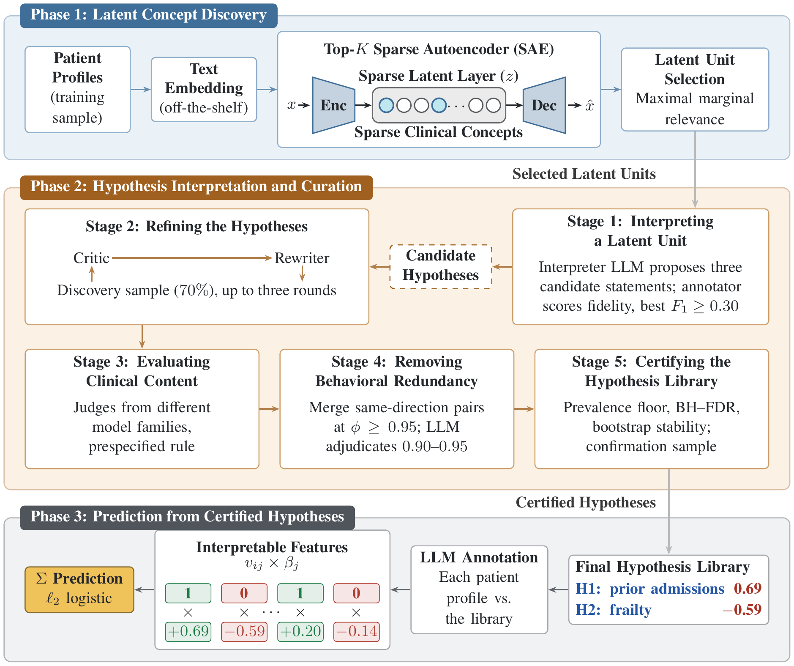

# Toward Trustworthy Hypotheses: Interpretable Clinical Prediction with LLMs

<p align="center">
  <a href="https://openreview.net/forum?id=StFJpkNqHl">
    
  </a>
  <a href="https://genai4health.github.io/2026-NeurIPS/">
    
  </a>
</p>

---

This is the codebase for our NeurIPS 2026 *GenAI4Health* workshop paper, which introduces
**CLIP-H** (Clinical Latent Interpretation & Prediction via Hypotheses).

---

## Overview

<p align="center">
  
</p>

Large language models can turn patient profiles into natural-language hypotheses, but directly
prompted hypotheses are often clinically unreliable, and their associations are rarely checked on
patients that were not used to form them. We evaluate CLIP-H on five binary prediction tasks built
from MIMIC-IV (in-hospital mortality, 30-day readmission, discharge destination, hospital length of
stay > 3 days, and ICU length of stay > 4 days) against direct LLM prediction, direct LLM
hypothesis generation, and feature-based baselines. CLIP-H works in three phases:

- **Phase 1, latent concept discovery:** a Top-K sparse autoencoder over profile embeddings finds
  concepts associated with the outcome.
- **Phase 2, interpretation and curation:** an LLM names each concept, and the hypotheses are
  refined, clinically reviewed, de-duplicated, and certified on held-out patients.
- **Phase 3, prediction:** a logistic regression over the certified hypotheses, so every
  prediction decomposes into named, auditable clinical concepts.

## Contents

- [Results](#results)
- [Repository structure](#repository-structure)
- [Data](#data)
- [Models](#models)
- [Reproduce the paper](#reproduce-the-paper)
- [Citation](#citation)
- [License](#license)

## Results

**AUROC (%)**

<table>
  <tr>
    <th align="left">Method</th>
    <th width="150">Readm.</th>
    <th width="150">Mortality</th>
    <th width="150">Discharge</th>
    <th width="150">Hosp LOS<br>&gt;3d</th>
    <th width="150">ICU LOS<br>&gt;4d</th>
    <th width="150">Macro<br>Avg</th>
  </tr>
  <tr>
    <td colspan="7"><i>LLM direct prediction</i></td>
  </tr>
  <tr>
    <td>GPT-4.1 mini</td>
    <td align="center">60.03<br>(3.41)</td>
    <td align="center">77.56<br>(2.71)</td>
    <td align="center">68.46<br>(3.27)</td>
    <td align="center">71.37<br>(3.02)</td>
    <td align="center">61.83<br>(3.32)</td>
    <td align="center">67.85<br>(1.41)</td>
  </tr>
  <tr>
    <td>DeepSeek-V4 Flash</td>
    <td align="center">65.09<br>(3.40)</td>
    <td align="center">60.44<br>(3.71)</td>
    <td align="center">73.33<br>(3.17)</td>
    <td align="center">72.07<br>(3.14)</td>
    <td align="center">67.89<br>(3.31)</td>
    <td align="center">67.76<br>(1.44)</td>
  </tr>
  <tr>
    <td colspan="7"><i>LLM direct hypothesis generation</i></td>
  </tr>
  <tr>
    <td>GPT-4.1</td>
    <td align="center">59.33<br>(3.46)</td>
    <td align="center">80.75<br>(2.61)</td>
    <td align="center">70.38<br>(3.27)</td>
    <td align="center">71.96<br>(3.15)</td>
    <td align="center">61.16<br>(3.49)</td>
    <td align="center">68.71<br>(1.44)</td>
  </tr>
  <tr>
    <td>DeepSeek-V4</td>
    <td align="center">56.97<br>(3.31)</td>
    <td align="center">75.24<br>(2.84)</td>
    <td align="center">60.09<br>(3.43)</td>
    <td align="center">65.52<br>(3.05)</td>
    <td align="center">59.84<br>(3.22)</td>
    <td align="center">63.53<br>(1.43)</td>
  </tr>
  <tr>
    <td colspan="7"><i>Feature-based baselines</i></td>
  </tr>
  <tr>
    <td>TF-IDF + LR</td>
    <td align="center">69.34<br>(3.20)</td>
    <td align="center">88.25<br>(2.02)</td>
    <td align="center">78.10<br>(2.83)</td>
    <td align="center">79.01<br>(2.78)</td>
    <td align="center">71.81<br>(3.14)</td>
    <td align="center">77.30<br>(1.27)</td>
  </tr>
  <tr>
    <td>LR</td>
    <td align="center">62.83<br>(3.50)</td>
    <td align="center">87.07<br>(2.11)</td>
    <td align="center">79.99<br>(2.71)</td>
    <td align="center">76.87<br>(2.85)</td>
    <td align="center">67.90<br>(3.26)</td>
    <td align="center">74.93<br>(1.31)</td>
  </tr>
  <tr>
    <td>XGBoost</td>
    <td align="center">66.55<br>(3.29)</td>
    <td align="center">91.90<br>(1.61)</td>
    <td align="center">81.50<br>(2.58)</td>
    <td align="center">78.77<br>(2.73)</td>
    <td align="center">69.54<br>(3.22)</td>
    <td align="center">77.65<br>(1.23)</td>
  </tr>
  <tr>
    <td colspan="7"><i>Ours</i></td>
  </tr>
  <tr>
    <td><b>CLIP-H<br>(GPT-4.1)</b></td>
    <td align="center">62.89<br>(3.49)</td>
    <td align="center">83.40<br>(2.44)</td>
    <td align="center"><b>79.84</b><br>(2.70)</td>
    <td align="center"><b>75.39</b><br>(2.99)</td>
    <td align="center"><b>69.49</b><br>(3.26)</td>
    <td align="center"><b>74.20</b><br>(1.36)</td>
  </tr>
  <tr>
    <td><b>CLIP-H<br>(DeepSeek-V4)</b></td>
    <td align="center">62.81<br>(3.42)</td>
    <td align="center"><b>82.33</b><br>(2.52)</td>
    <td align="center"><b>77.38</b><br>(2.92)</td>
    <td align="center">73.74<br>(3.07)</td>
    <td align="center">64.48<br>(3.24)</td>
    <td align="center"><b>72.15</b><br>(1.34)</td>
  </tr>
</table>

**F1 (%)**

<table>
  <tr>
    <th align="left">Method</th>
    <th width="150">Readm.</th>
    <th width="150">Mortality</th>
    <th width="150">Discharge</th>
    <th width="150">Hosp LOS<br>&gt;3d</th>
    <th width="150">ICU LOS<br>&gt;4d</th>
    <th width="150">Macro<br>Avg</th>
  </tr>
  <tr>
    <td colspan="7"><i>LLM direct prediction</i></td>
  </tr>
  <tr>
    <td>GPT-4.1 mini</td>
    <td align="center">60.81<br>(3.47)</td>
    <td align="center">23.22<br>(4.39)</td>
    <td align="center">67.47<br>(3.12)</td>
    <td align="center">68.05<br>(3.17)</td>
    <td align="center">62.37<br>(3.35)</td>
    <td align="center">56.38<br>(1.63)</td>
  </tr>
  <tr>
    <td>DeepSeek-V4 Flash</td>
    <td align="center">55.34<br>(3.87)</td>
    <td align="center">45.63<br>(4.76)</td>
    <td align="center">68.53<br>(3.26)</td>
    <td align="center">68.37<br>(3.20)</td>
    <td align="center">66.90<br>(3.23)</td>
    <td align="center">60.95<br>(1.63)</td>
  </tr>
  <tr>
    <td colspan="7"><i>LLM direct hypothesis generation</i></td>
  </tr>
  <tr>
    <td>GPT-4.1</td>
    <td align="center">56.00<br>(3.70)</td>
    <td align="center">73.40<br>(3.15)</td>
    <td align="center">66.80<br>(3.40)</td>
    <td align="center">67.40<br>(3.34)</td>
    <td align="center">59.00<br>(3.65)</td>
    <td align="center">64.52<br>(1.54)</td>
  </tr>
  <tr>
    <td>DeepSeek-V4</td>
    <td align="center">53.20<br>(3.72)</td>
    <td align="center">70.94<br>(3.15)</td>
    <td align="center">56.20<br>(3.64)</td>
    <td align="center">60.80<br>(3.49)</td>
    <td align="center">57.80<br>(3.66)</td>
    <td align="center">59.79<br>(1.59)</td>
  </tr>
  <tr>
    <td colspan="7"><i>Feature-based baselines</i></td>
  </tr>
  <tr>
    <td>TF-IDF + LR</td>
    <td align="center">64.20<br>(3.45)</td>
    <td align="center">79.80<br>(2.72)</td>
    <td align="center">71.00<br>(3.20)</td>
    <td align="center">73.20<br>(3.09)</td>
    <td align="center">66.40<br>(3.46)</td>
    <td align="center">70.92<br>(1.41)</td>
  </tr>
  <tr>
    <td>LR</td>
    <td align="center">60.40<br>(3.62)</td>
    <td align="center">77.00<br>(2.93)</td>
    <td align="center">72.40<br>(3.14)</td>
    <td align="center">68.80<br>(3.25)</td>
    <td align="center">62.40<br>(3.56)</td>
    <td align="center">68.20<br>(1.49)</td>
  </tr>
  <tr>
    <td>XGBoost</td>
    <td align="center">61.80<br>(3.54)</td>
    <td align="center">83.00<br>(2.53)</td>
    <td align="center">72.40<br>(3.18)</td>
    <td align="center">71.60<br>(3.18)</td>
    <td align="center">64.60<br>(3.45)</td>
    <td align="center">70.68<br>(1.43)</td>
  </tr>
  <tr>
    <td colspan="7"><i>Ours</i></td>
  </tr>
  <tr>
    <td><b>CLIP-H<br>(GPT-4.1)</b></td>
    <td align="center">59.00<br>(3.64)</td>
    <td align="center">75.20<br>(2.96)</td>
    <td align="center"><b>71.80</b><br>(3.15)</td>
    <td align="center">69.00<br>(3.33)</td>
    <td align="center">65.60<br>(3.43)</td>
    <td align="center"><b>68.12</b><br>(1.50)</td>
  </tr>
  <tr>
    <td><b>CLIP-H<br>(DeepSeek-V4)</b></td>
    <td align="center">59.80<br>(3.60)</td>
    <td align="center">73.55<br>(3.07)</td>
    <td align="center">70.00<br>(3.25)</td>
    <td align="center">68.40<br>(3.30)</td>
    <td align="center">58.20<br>(3.62)</td>
    <td align="center"><b>65.99</b><br>(1.50)</td>
  </tr>
</table>

Values in parentheses are half-widths of 95% percentile bootstrap intervals (10,000 resamples of
the 1,000 test patients). **Bold** marks cells where CLIP-H is significantly better than both LLM
comparators of the same backbone (paired bootstrap, Holm-corrected within each task, α = 0.05).
LLM direct prediction is scored at its own Yes/No answer, and the other methods at the
prevalence-matched operating point (the top 500 scores are positive).

Where each row comes from:

| Rows | Produced by | File |
|---|---|---|
| CLIP-H, readmission / hospital LOS / ICU LOS | `clip_h/<task>/*_runner_<arm>.ipynb` | `results/<run>/<task>_<arm>/phase3_prediction/heldout_metrics.json` |
| CLIP-H, mortality / discharge | `clip_h/<task>/<task>_runner_<arm>.ipynb` | `clip_h_runs/<run>/heldout_metrics.csv` |
| LLM direct hypotheses | `direct_llm_hypotheses/direct_hypotheses_<arm>.ipynb` | `results/<run>/<task>_<arm>/phase3_prediction/heldout_metrics.json` |
| LLM direct prediction | `direct_llm_baseline/direct_llm_baseline.py` | `results/<task>/<arm>/confidence/all_instances.jsonl` |
| Feature baselines, all five tasks | `feature_baselines/run_baselines.py <task>` | `feature_baselines/results/<task>/summary.csv` |


## Repository structure

```
CLIP-H/
├── mimic_cleaning/          raw MIMIC-IV → data/<task>/ for the five tasks (no API calls)
├── data/                    data/<task>/: what every method reads (not in git)
├── clip_h/
│   ├── readmission/         CLIP-H runners (GPT, DeepSeek), code/, prompts/
│   ├── hosp_los/            same layout
│   ├── icu_los/             same layout
│   ├── mortality/           CLIP-H runners (GPT, DeepSeek), mimic_eval/, myHypotheSAEs/
│   └── discharge/           same layout
├── direct_llm_hypotheses/   comparator: LLM-written hypotheses, scored like CLIP-H
├── direct_llm_baseline/     comparator: the LLM predicts each test patient directly
├── feature_baselines/       TF-IDF + LR, LR and XGBoost for all five tasks
├── LICENSE                  MIT
└── THIRD_PARTY_NOTICES.md   HypotheSAEs (Apache-2.0)
```

| Folder | What it does |
|---|---|
| [`mimic_cleaning/`](mimic_cleaning/) | Cleans raw MIMIC-IV v3.1 into cohorts, train/test files and patient text profiles for all five tasks. |
| [`clip_h/readmission/`](clip_h/readmission/), [`hosp_los/`](clip_h/hosp_los/), [`icu_los/`](clip_h/icu_los/) | CLIP-H for 30-day readmission, hospital length of stay > 3 days, ICU length of stay > 4 days. The three `code/` folders are the same; a task is its Settings cell and `prompts/`. |
| [`clip_h/mortality/`](clip_h/mortality/), [`discharge/`](clip_h/discharge/) | CLIP-H for in-hospital mortality and discharge home, with the `mimic_eval` library and the modified HypotheSAEs package. |
| [`direct_llm_hypotheses/`](direct_llm_hypotheses/) | LLM direct hypotheses: an LLM writes hypotheses from labeled train profiles; patients are annotated with CLIP-H's annotation code and scored the same way. |
| [`direct_llm_baseline/`](direct_llm_baseline/) | LLM direct prediction: the LLM gives each test patient a label and a probability. |
| [`feature_baselines/`](feature_baselines/) | Feature baselines for all five tasks: TF-IDF + logistic regression, structured logistic regression and XGBoost, fit on the same train/test split as CLIP-H and scored at the same operating point. |

Each folder has its own README and `requirements.txt`.

## Data

MIMIC-IV needs credentialed access through [PhysioNet](https://physionet.org/content/mimiciv/),
so no patient data, results or caches are included (`data/` holds only an empty placeholder).
`mimic_cleaning/` writes `data/<task>/` for the five tasks, and every method reads it:
`train_profile.jsonl`, `test_profile.jsonl`, `train_labels.csv`, `test_labels.csv`, `train.jsonl`,
`test.jsonl` (mortality and discharge also get the rows their runners need, as parquet).

| Task | Positive class | Predicted at | Data folder |
|---|---|---|---|
| Mortality | death during the admission | admission | `data/mortality/` |
| Readmission | readmission within 30 days of a live discharge | discharge | `data/readmission/` |
| Discharge | discharge to a private home without services | admission | `data/discharge/` |
| Hospital LOS | hospital stay longer than 72 hours | first 24 hours | `data/hosp_los3/` |
| ICU LOS | ICU stay longer than 96 hours | first 24 hours of the ICU stay | `data/icu_los4/` |

## Models

Within each role, the same model is used in every task and method, and the two arms differ only in
the model family. OpenAI models are called by dated snapshot. DeepSeek runs with thinking off in
every CLIP-H and direct-hypotheses call.

| Role | GPT arm | DeepSeek arm |
|---|---|---|
| Profile embedder (local) | Qwen3-Embedding-0.6B | Qwen3-Embedding-0.6B |
| Interpreter: names SAE neurons (and the ultra-sparse groups in readmission and the LOS tasks) | `gpt-4.1-2025-04-14` | `deepseek-v4-pro` |
| Self-refinement critic and rewriter | `gpt-5-2025-08-07` | `deepseek-v4-pro` |
| Clinical review | readmission and LOS tasks: Claude Opus 5, in a manual chat; mortality and discharge: `gpt-5-2025-08-07` + `claude-opus-4-8` | readmission and LOS tasks: Claude Opus 5, in a manual chat; mortality and discharge: `deepseek-v4-pro` + `claude-opus-4-8` |
| Deduplication adjudicator | `gpt-5-2025-08-07` | `deepseek-v4-flash` |
| Annotator (every binary label) | `gpt-4.1-mini-2025-04-14` | `deepseek-v4-flash` |
| LLM direct hypotheses: generator / annotator | `gpt-4.1-2025-04-14` / `gpt-4.1-mini-2025-04-14` | `deepseek-v4-pro` / `deepseek-v4-flash` |
| LLM direct prediction | `gpt-4.1-mini-2025-04-14` | `deepseek-v4-flash` |

## Reproduce the paper

Install and run each step from inside its folder.

1. **Get MIMIC-IV version 3.1** from PhysioNet (credentialed access) and put its `hosp/` and
   `icu/` folders in `mimic_cleaning/mimic-iv-3.1/`.
2. **Build the patient files** for the five tasks:
   ```bash
   cd mimic_cleaning
   pip install -r requirements.txt
   python run/run_readmission.py    # and run_hosp_los.py, run_icu_los.py, run_mortality.py, run_discharge.py
   ```
   Each writes `data/<task>/`.
3. **Run CLIP-H**: open a runner notebook in `clip_h/<task>/` (one for the GPT arm, one for the
   DeepSeek arm) and run its cells top to bottom. The readmission, hosp_los and icu_los runners
   stop once, on purpose, at Phase 2C+ for the manual review step (their README, section 3).
4. **Run the comparators** on the same `data/<task>/`: `direct_llm_baseline/` (one script) and
   `direct_llm_hypotheses/` (two notebooks).
5. **Run the feature baselines** for each task: `cd feature_baselines && python run_baselines.py <task>`.

Every reply is cached, so a stopped run resumes without paying twice. Hosted models are not exactly
deterministic, so a rerun from scratch can differ slightly from the reported numbers.

## Citation

If you use this code, please cite MIMIC-IV and HypotheSAEs:

```bibtex
@article{johnson2023mimiciv,
  title   = {{MIMIC-IV}, a freely accessible electronic health record dataset},
  author  = {Johnson, Alistair E. W. and Bulgarelli, Lucas and Shen, Lu and Gayles, Alvin and Shammout, Ayad and Horng, Steven and Pollard, Tom J. and Hao, Sicheng and Moody, Benjamin and Gow, Brian and Lehman, Li-wei H. and Celi, Leo A. and Mark, Roger G.},
  journal = {Scientific Data},
  volume  = {10},
  number  = {1},
  year    = {2023},
  doi     = {10.1038/s41597-022-01899-x},
}

@misc{movva_sparse_2025,
  title         = {Sparse Autoencoders for Hypothesis Generation},
  author        = {Rajiv Movva and Kenny Peng and Nikhil Garg and Jon Kleinberg and Emma Pierson},
  year          = {2025},
  eprint        = {2502.04382},
  archivePrefix = {arXiv},
  primaryClass  = {cs.CL},
  url           = {https://arxiv.org/abs/2502.04382},
}
```

## License

The code in this repository is released under the MIT License (see [`LICENSE`](LICENSE)). It
includes code from [HypotheSAEs](https://github.com/rmovva/HypotheSAEs), which remains under the
Apache License 2.0; [`THIRD_PARTY_NOTICES.md`](THIRD_PARTY_NOTICES.md) lists where it is used.
MIMIC-IV data are not included; they are available from PhysioNet to credentialed users under the
PhysioNet Credentialed Health Data License 1.5.0.
